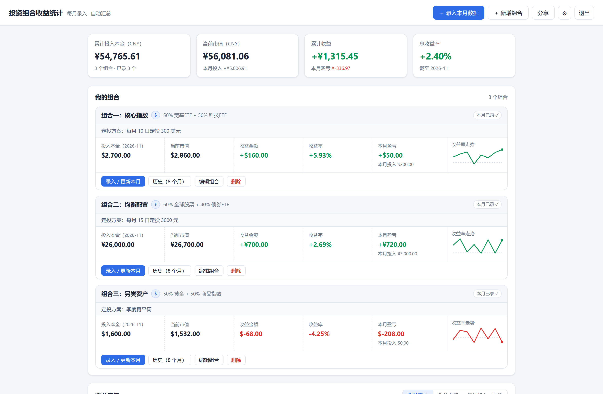
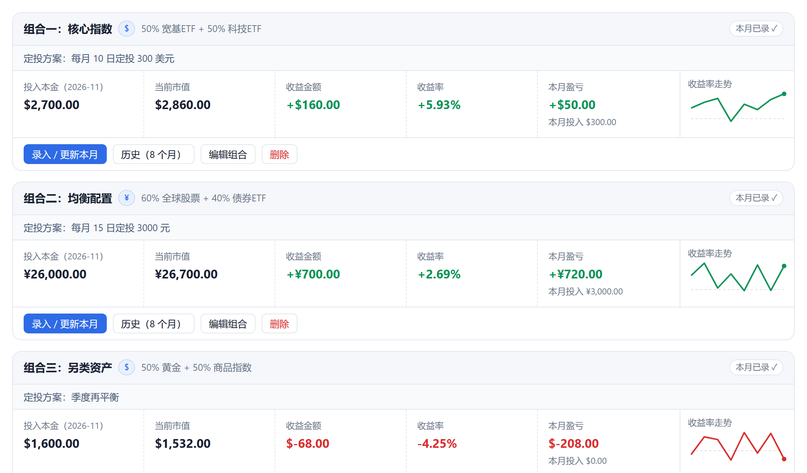
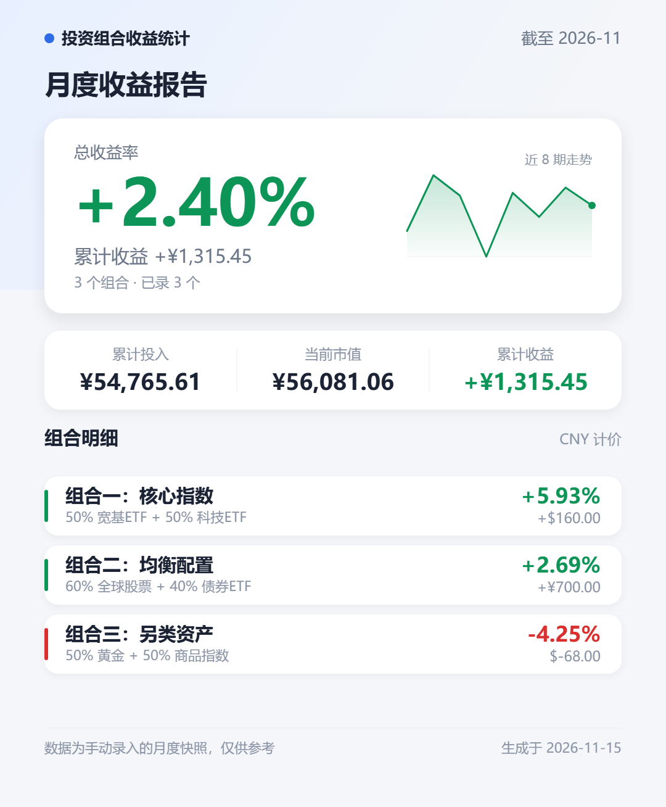
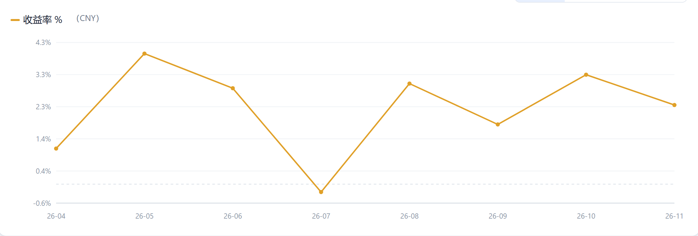
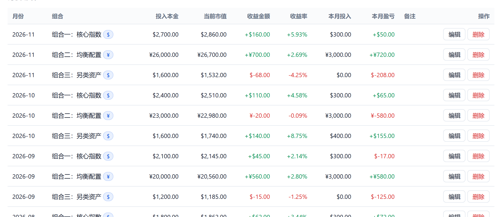
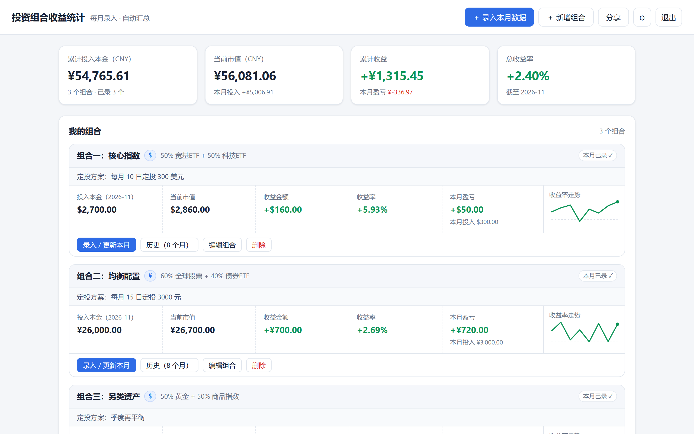

# 投资组合月度收益统计

> 自托管的个人投资组合记账站：每月填两个数，自动算出收益、收益率、本月盈亏和跨组合汇总。
> **本项目全部代码由 DeepSeek v4.1 FLASH 模型编写。**




---

## 目录

- [为什么做这个](#为什么做这个)
- [功能特性](#功能特性)
- [界面预览](#界面预览)
- [快速开始](#快速开始)
- [收益口径](#收益口径)
- [配置项](#配置项)
- [数据与备份](#数据与备份)
- [项目结构](#项目结构)
- [技术选型](#技术选型)
- [安全说明](#安全说明)
- [常见问题](#常见问题)
- [参与贡献](#参与贡献)
- [声明](#声明)

---

## 为什么做这个

原本用一张 Excel 表记「模拟盘」：每个组合一行，写累计投入和当前市值，收益和收益率手算。月份一多，表格越来越长，跨表汇总容易错，还只能在电脑上看。

这个项目把那套表格逻辑原样搬到网页上：

- **只填两个数** —— 投入本金（累计）、当前市值，其余全自动
- **重复提交即覆盖** —— 同月再录一次就是改数，不会出现两条记录
- **数据在自己手里** —— SQLite 单文件落在 NAS 上，不联网、不上云、不接券商 API

## 功能特性

**录入**

- 组合增删改，支持名称、配置明细、定投方案、计价币种（USD / CNY / HKD）
- 按月录入累计本金与市值，支持补录历史月份
- 同月重复提交自动 upsert 覆盖，改数不留脏数据

**计算**

- 收益金额 = 市值 − 本金；收益率 = 收益 ÷ 本金
- 本月投入 = 本月累计 − 上月累计；本月盈亏 = (本月市值 − 上月市值) − 本月投入
- 跨币种自动折人民币汇总（汇率 6 小时缓存，可手动覆盖）
- 首月、跳月、缺记录都不会算出 NaN，边界按「首月即全额」处理

**展示**

- 汇总卡：累计投入 / 当前市值 / 累计收益 / 总收益率
- 组合卡：每个组合的最新四项指标 + 迷你走势线
- 走势图：收益率、收益金额、投入与市值三视图切换，手写 SVG，无图表库
- 月度明细：全部记录的平铺表格，可逐条改删

**其他**

- 一键生成 **1080 宽 PNG 分享图**（Canvas 手绘，可直接发微信）
- JSON 全量导出 / 导入（合并或替换两种模式）
- 密码认证：HMAC 无状态 Cookie，同 IP 5 次失败锁 10 分钟
- 敏感操作二次确认：删除组合、删除记录、修改组合、覆盖同月、替换导入，都要手输「确认」
- 响应式布局，手机浏览器可直接用

## 界面预览

| 主页汇总与组合卡 | 分享图（1080 × 1308） |
|---|---|
|  |  |

| 收益走势 | 月度明细 |
|---|---|
|  |  |

登录页（密码认证开启时，未登录拿不到任何数据和接口）：



> 截图中的组合名称与金额均为虚构演示数据。

## 快速开始

> 只有一条路径：**在干净环境里从零装好**。没有升级包、没有迁移工具 —— 换版本就拿新代码重装一遍，数据用 JSON 搬。

### Docker Compose（推荐）

```bash
git clone https://github.com/caddaric9527/portfolio-tracker.git
cd portfolio-tracker
cp .env.example .env
# 编辑 .env，把 AUTH_PASSWORD 设成你自己的密码；不改也行，deploy.sh 会自动生成
sudo bash deploy.sh
```

打开 `http://<设备IP>:8888`，输入密码。首次构建约 1~3 分钟（主要耗在拉基础镜像）。

`deploy.sh` 只负责全新安装，**检测到已有部署会直接退出**而不是覆盖数据，由你显式选模式：

| 命令 | 场景 | 对数据做什么 |
|---|---|---|
| `sudo bash deploy.sh` | 干净设备首次安装 | 要求无 `data/`、无同名容器 |
| `sudo bash deploy.sh --wipe` | 彻底清空重来 | 旧 `data/` 改名成 `data.bak.<时间戳>` 保留，空库重装 |
| `sudo bash deploy.sh --keep-data` | 只换代码 | 原样保留，仅重建镜像 |
| `sudo bash deploy.sh --help` | — | 打印帮助 |

装完想确认真的生效：

```bash
sudo bash check-deploy.sh   # 六段自检：源码 → 容器 → 镜像内文件 → 端口真实返回 → 数据 → 认证
```

### 不用 deploy.sh 的等价写法

```bash
docker compose up -d --build && docker compose ps
```

默认不设 `AUTH_PASSWORD` 时认证是关闭的，启动日志会告警 —— 自己手动装的话记得在 `.env` 里填上。

### 本地开发

```bash
npm install
AUTH_PASSWORD=dev PORT=8080 npm start      # http://localhost:8080
npm run dev                                 # 或带 --watch 热重启
```

需要 Node.js ≥ 20（推荐 22，见 `.nvmrc`）。`better-sqlite3` 是原生模块，首次 `npm install` 会编译。

### 部署到 NAS

飞牛 fnOS / 群晖 DSM 的图形化步骤、端口修改、镜像加速、权限报错处理，见 [`部署说明.txt`](部署说明.txt)。

## 收益口径

所有指标都由「累计投入」与「当前市值」两条时间序列推导，不猜行情、不插值。

| 指标 | 公式 | 说明 |
|---|---|---|
| 收益金额 | `市值 − 本金` | 累计口径 |
| 收益率 | `收益 ÷ 本金 × 100%` | 本金为 0 时返回 `null`，不显示 0% |
| 本月投入 | `本月累计本金 − 上月累计本金` | 首月即全额 |
| 本月盈亏 | `(本月市值 − 上月市值) − 本月投入` | 首月即收益金额 |
| 汇总币种 | 全部组合同币种 → 用该币种；跨币种 → 折 CNY | 汇率来自 open.er-api.com |

> 市值由你从券商/交易所 App 看到的数字手动填入，本项目不拉行情、不接交易接口。

## 配置项

全部通过环境变量注入，`.env` 只在本机生效、不入库。

| 变量 | 默认 | 说明 |
|---|---|---|
| `HOST_PORT` | `8888` | 宿主机映射端口（仅 `docker-compose.yml` 使用） |
| `AUTH_PASSWORD` | 空 | 访问密码。留空 = 关闭认证（启动日志会告警，不推荐） |
| `AUTH_DAYS` | `30` | 登录状态保留天数 |
| `DATA_DIR` | `./data`（容器内 `/app/data`） | SQLite 与签名密钥存放目录 |
| `PORT` | `8080` | 容器内监听端口 |
| `TZ` | `Asia/Shanghai` | 时区，影响「本月」判定 |

## 数据与备份

三种备份方式，按可靠性排序：

1. **网页导出**：右上 ⚙ → 导出 JSON（全量组合 + 记录），体积小、可读、可 diff
2. **拷数据库**：`cp data/portfolio.db /path/to/backup/`（WAL 模式下建议先 `docker compose down`）
3. **整目录**：迁移到新设备时整个 `data/` 拷走即可，含签名密钥（登录态也跟着走）

恢复：⚙ → 导入备份（合并 / 替换），或停容器后用备份文件覆盖 `data/portfolio.db` 并删掉同目录 `-shm` / `-wal`。

**迁移到新设备**：新设备走一遍全新安装，再导入 JSON。不用拷数据库、不用拷任何旧版文件。

**彻底重置成刚装好的样子**：

```bash
sudo bash deploy.sh --wipe    # 旧库改名备份 → 空库重装
```

## 项目结构

```
portfolio-tracker/
├── server/
│   ├── index.js        # 入口：中间件顺序、静态资源、错误兜底
│   ├── routes.js       # 全部 API：组合 CRUD、记录 upsert、汇总、导入导出
│   ├── db.js           # better-sqlite3 建表、迁移、设置读写
│   ├── auth.js         # 密码校验、HMAC 令牌、限流、页面/接口守卫
│   └── fx.js           # 汇率抓取与缓存
├── public/
│   ├── index.html      # 主页面骨架 + 三个弹窗
│   ├── login.html      # 登录页（内联样式，不依赖其他资源）
│   ├── app.js          # 全部交互：渲染、表单、图表、分享图、二次确认
│   └── style.css       # 设计变量、卡片、图表、响应式
├── docs/
│   ├── API.md          # 接口清单与请求示例
│   ├── ARCHITECTURE.md # 数据流、表结构、中间件顺序
│   └── screenshots/    # README 用截图
├── .github/            # CI、Issue/PR 模板、dependabot
├── Dockerfile
├── docker-compose.yml
├── deploy.sh           # 全新安装：环境校验 → 生成密码 → 构建 → 等待健康 → 自检（支持 --wipe / --keep-data）
├── check-deploy.sh     # 部署后六段自检
└── 部署说明.txt         # 全新安装指南（NAS 命令行 + 图形面板）
```

## 技术选型

| 选择 | 原因 |
|---|---|
| Express + better-sqlite3 | 单机自托管场景，同步 SQLite 足够快，没有连接池和迁移框架的负担 |
| 原生 HTML/CSS/JS | 零构建、零 CDN，内网离线可用；页面逻辑量级不值得引入框架 |
| 手写 SVG 折线图 | 图表需求只有三条线，Canvas/SVG 直接画比引库更可控，也能直接复用到分享图 |
| 无状态 HMAC 令牌 | 不引入 session 存储，容器重建不掉登录；密钥持久化在 `data/.auth-secret` |
| 单镜像 Compose | 目标用户是 NAS 用户，一条 `up -d` 要能跑起来 |

## 安全说明

- 密码以 **SHA-256 摘要** 存储比对，使用 `timingSafeEqual` 防时序侧信道；明文只在 `.env` 和容器环境变量里
- 登录令牌为 `base64url(payload) + HMAC-SHA256` 签名，放在 `HttpOnly` + `SameSite=Lax` Cookie，前端 JS 读不到
- 同 IP 连续 5 次密码错误锁定 10 分钟；改密码后想强制所有设备下线，删 `data/.auth-secret` 重启即可
- 所有 SQL 走 `prepare` 参数绑定；用户输入在渲染前经 `esc()` 转义
- 默认走 **HTTP 明文**，只适合内网。需要外网访问请用 Nginx Proxy Manager / Caddy 套 HTTPS

## 常见问题

**改了代码，浏览器还是旧页面？**
静态资源已设 `Cache-Control: no-cache` + ETag，正常刷新即可。若改了 `server/` 必须 `docker compose up -d --build`，只改 `public/` 用 `restart` 就够。

**端口被占用 / 打不开？**
改 `.env` 的 `HOST_PORT` 后 `docker compose up -d`；打不开先跑 `bash check-deploy.sh`，按 `[FAIL]` 项排查。

**拉镜像卡住？**
首次构建要从 Docker Hub 拉 `node:22-bookworm-slim`。在 NAS 的 Docker 设置里加国内镜像加速地址后重试。

**忘了密码？**
`.env` 里改 `AUTH_PASSWORD`，`docker compose up -d` 即可。被锁定了就 `docker compose restart` 清空限流计数。

**能接行情自动更新吗？**
不做。这个工具的定位是「记录你自己确认过的快照」，自动拉行情会把口径搞混（复权、汇率、时点）。

## 参与贡献

欢迎 issue 和 PR。提交前请先看 [CONTRIBUTING.md](CONTRIBUTING.md)，安全问题请按 [SECURITY.md](SECURITY.md) 的方式私下反馈。

版本变更见 [CHANGELOG.md](CHANGELOG.md)。

## 声明

- **代码编写模型：DeepSeek v4.1 FLASH**（仓库内所有源码文件头部均有标注）
- 仓库内容已脱敏：不含真实持仓金额、真实组合配置、个人昵称、内网地址、密码与密钥；`.env` 不入库，仅提供 `.env.example`
- 本项目仅用于个人记账，**不构成任何投资建议**；数据由使用者自行录入与判断
- 未附带开源许可证，默认保留所有权利；引用或二次分发请先联系仓库作者
